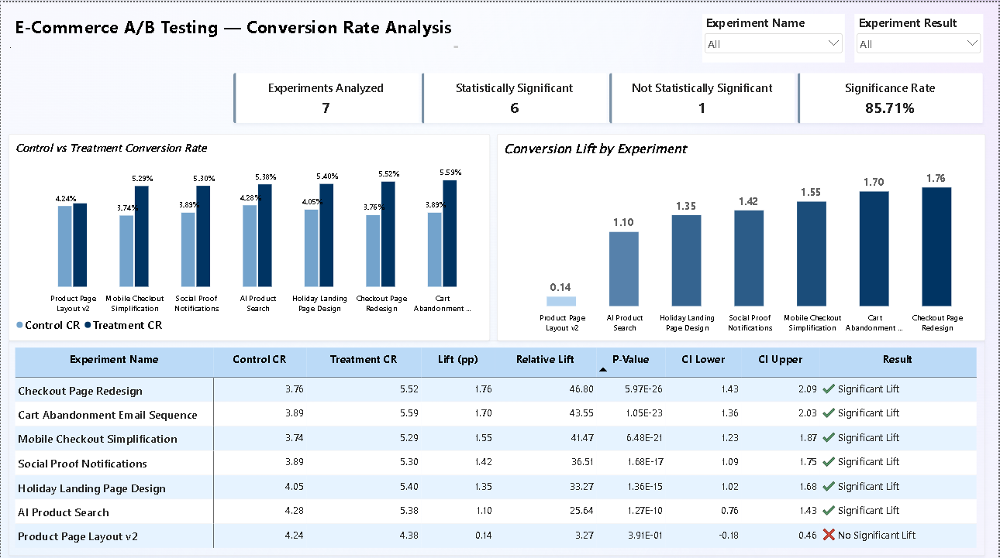
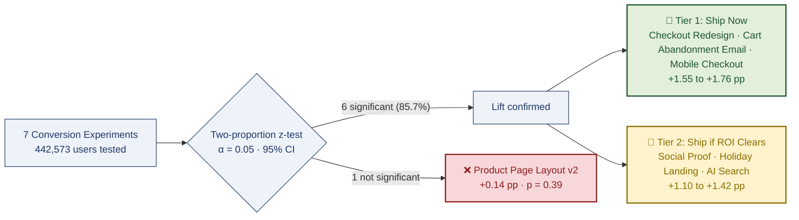
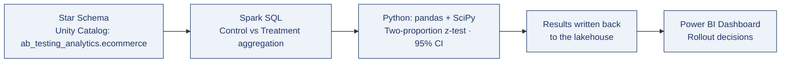

# 🧪 E-Commerce A/B Testing — Conversion Rate Analysis
### Experiment Decision Report | Databricks + Spark SQL + Python + Power BI

<p align="center">

</p>

<p align="center">


</p>

---

## 🧭 Section Switcher
### 👇 Click any section to jump straight to it

<p align="center">
<a href="#results"></a>
<a href="#insights"></a>
<a href="#rollout"></a>
<br>
<a href="#impact"></a>
<a href="#model"></a>
</p>

---

## ⚡ Headline Snapshot

| Metric | Result |
|---|---|
| **Experiments analyzed** | 7 conversion-rate experiments |
| **Statistically significant** | 6 of 7 (**85.7% win rate**) |
| **Average lift (winners)** | **+1.48 pp** absolute · **+37.9%** relative |
| **Best single change** | Checkout Page Redesign: 3.76% → 5.52% (+1.76 pp, +46.8%) |
| **Users tested** | 442,573 across 14 variant arms (~31.6K distinct users per arm) |
| **Rigor** | Two-sided z-test, α = 0.05, 95% CIs; every winner p ≤ 1.3 × 10⁻¹⁰ |

---

## 🎯 Business Objective

> Turn raw experiment logs into a statistically validated, executive-ready rollout decision: for each conversion-rate experiment, determine whether the treatment truly beats control, by how much (with a confidence range), and which changes the business should ship, sequence, or drop.

**Executive Summary:** Six of seven experiments produced a real conversion lift. The three biggest winners all act on the **checkout and cart stage**, where purchase intent is highest, and should ship first. One experiment (Product Page Layout v2) showed no meaningful effect and should be shelved so design and engineering effort goes where the evidence points.

---

<a id="results"></a>
## 🏆 Experiment Results (Ranked by Lift)

| Experiment | Control CR | Treatment CR | Lift (pp) | Relative Lift | P-value | 95% CI (pp) | Decision |
|---|---|---|---|---|---|---|---|
| Checkout Page Redesign | 3.76% | 5.52% | **+1.76** | +46.8% | 6.0e-26 | [1.43, 2.09] | 🥇 Ship now |
| Cart Abandonment Email Sequence | 3.89% | 5.59% | **+1.70** | +43.6% | 1.1e-23 | [1.36, 2.03] | 🥇 Ship now |
| Mobile Checkout Simplification | 3.74% | 5.29% | **+1.55** | +41.5% | 6.5e-21 | [1.23, 1.87] | 🥇 Ship now |
| Social Proof Notifications | 3.89% | 5.30% | +1.42 | +36.5% | 1.7e-17 | [1.09, 1.75] | 🥈 Ship if ROI clears |
| Holiday Landing Page Design | 4.05% | 5.40% | +1.35 | +33.3% | 1.4e-15 | [1.02, 1.68] | 🥈 Ship if ROI clears |
| AI Product Search | 4.28% | 5.38% | +1.10 | +25.6% | 1.3e-10 | [0.76, 1.43] | 🥈 Ship if ROI clears |
| Product Page Layout v2 | 4.24% | 4.38% | +0.14 | +3.3% | 0.391 | [−0.18, 0.46] | ❌ Do not ship |

*Lift in percentage points (pp). CI is the 95% confidence interval for the lift. Tier 1 = CI floor above +1.2 pp; Tier 2 = real but smaller or costlier to deliver.*

---

## 🗺️ From Experiment to Decision



---

<a id="insights"></a>
## 🔬 Business Insights (Insight → Action → Risk)

<details open>
<summary><b>1️⃣ Checkout and Cart Are the Highest-Leverage Surfaces in the Funnel</b> &nbsp; </summary>

| | |
|---|---|
| 📌 **INSIGHT** | The three largest lifts all act on the checkout and cart stage: Checkout Page Redesign (+1.76 pp, +46.8%), Cart Abandonment Email (+1.70 pp, +43.6%) and Mobile Checkout Simplification (+1.55 pp, +41.5%). Everything outside checkout lifted +1.10 to +1.42 pp. |
| 🎯 **WHY IT MATTERS** | Users at checkout have already decided to buy, so removing friction there converts directly into orders. The same effort higher in the funnel has to first create intent. |
| 🛠️ **ACTION** | Ship Checkout Page Redesign first (largest lift, CI floor +1.43 pp), then the Cart Abandonment Email (low-effort automation), then Mobile Checkout Simplification. Release in stages, each against a holdout group. |
| ⚠️ **RISK** | These changes hit overlapping funnel stages, so their lifts do **not** add up. A naive sum (+5.0 pp) would imply conversion jumping from ~3.8% to ~8.8%, which is unrealistic. Measure the combined effect before forecasting. |

</details>

<details>
<summary><b>2️⃣ The Wins Hold Up Under Strict Statistical Scrutiny</b> &nbsp; </summary>

| | |
|---|---|
| 📌 **INSIGHT** | Running 7 tests at α = 0.05 carries a ~30% chance of at least one false positive if none were real. Even against the stricter Bonferroni threshold (0.05 ÷ 7 ≈ 0.007), the weakest of the six winners (p = 1.3 × 10⁻¹⁰) passes easily, and every winner's confidence interval stays above zero. |
| 🎯 **WHY IT MATTERS** | Stakeholders can act on these results without worrying that they are a by-product of running many tests at once. |
| 🛠️ **ACTION** | Report the **CI floor** (the conservative end of the range) to stakeholders as the planning number, and treat the gap up to the point estimate as upside. |
| ⚠️ **RISK** | Significance is not durability. Picking the best-looking winners tends to overstate their true lift (winner's curse), and novelty effects can fade. Keep a 5–10% holdout after launch and confirm the lift holds in production. |

</details>

<details>
<summary><b>3️⃣ Second-Tier Wins Are Real, but Should Clear an ROI Check First</b> &nbsp; </summary>

| | |
|---|---|
| 📌 **INSIGHT** | Social Proof Notifications (+1.42 pp), Holiday Landing Page (+1.35 pp) and AI Product Search (+1.10 pp) are statistically solid, but each needs 70 to 91 users to produce one extra order, versus 57 to 65 users for the Tier 1 changes. |
| 🎯 **WHY IT MATTERS** | A smaller lift only pays off if the build and run cost is proportionally smaller. AI-powered search in particular typically carries the highest build and run cost of the group. |
| 🛠️ **ACTION** | Ship Social Proof Notifications in the next sprint if it is lightweight. Gate AI Product Search on a cost-per-incremental-order check against margin per order. |
| ⚠️ **RISK** | Launching several changes at once muddies attribution. Stagger releases and keep holdouts so each change's contribution stays measurable. |

</details>

<details>
<summary><b>4️⃣ The Holiday Landing Page Is the Only Winner With a Deadline</b> &nbsp; </summary>

| | |
|---|---|
| 📌 **INSIGHT** | Holiday Landing Page Design lifted conversion from 4.05% to 5.40% (+33.3% relative, CI floor +1.02 pp), but its value is only earned during the holiday window. |
| 🎯 **WHY IT MATTERS** | Every other winner pays off year-round. This one loses value each day it sits unshipped ahead of peak season. |
| 🛠️ **ACTION** | Sequence it ahead of the next peak-season traffic ramp, with a planned review and rollback date after the season. |
| ⚠️ **RISK** | A holiday-period lift should not be extrapolated to full-year revenue. Forecast its contribution only for the window it runs. |

</details>

<details>
<summary><b>5️⃣ Product Page Layout v2 Should Be Shelved, and the Test Was Strong Enough to Say So</b> &nbsp; </summary>

| | |
|---|---|
| 📌 **INSIGHT** | Conversion moved from 4.24% to 4.38% (+0.14 pp, p = 0.39, CI [−0.18, +0.46]). With ~31.6K users per arm and a ~4.2% baseline, the test could reliably detect lifts of ~0.45 pp or more. |
| 🎯 **WHY IT MATTERS** | This is a true "no meaningful effect" result, not an inconclusive one. The confidence interval rules out any lift above ~0.46 pp, so the layout is not worth further investment as designed. |
| 🛠️ **ACTION** | Do not ship. Redirect design and engineering capacity to the checkout-stage roadmap. If product pages are revisited, test a bolder variant rather than iterating on this one. |
| ⚠️ **RISK** | This experiment measured conversion only. The layout could still affect engagement or order value, so shelve the learnings rather than deleting them. |

</details>

<details>
<summary><b>6️⃣ The Experimentation Program Is Winning at an Exceptional Rate</b> &nbsp; </summary>

| | |
|---|---|
| 📌 **INSIGHT** | 6 of 7 experiments (85.7%) delivered a significant lift, averaging +1.48 pp (+37.9% relative) off baselines of 3.74% to 4.28%. That is far above the commonly cited rule of thumb that only a minority of tests (roughly a third or fewer) produce a win. |
| 🎯 **WHY IT MATTERS** | It signals strong hypothesis quality: the team is testing changes aimed at real friction points rather than cosmetic tweaks. |
| 🛠️ **ACTION** | Codify how these hypotheses were prioritized and keep the next wave queued, with the remaining checkout, payment and mobile-flow ideas at the front. |
| ⚠️ **RISK** | A high win rate can be inflated if abandoned or inconclusive tests go unlogged. Track every experiment, including the ones that never finish, so the hit rate stays honest. |

</details>

---

<a id="rollout"></a>
## 🚦 Rollout Priority Matrix

| Priority | Recommendation | Impact | Effort (est.) |
|---|---|---|---|
| 🥇 **P0** | Ship **Checkout Page Redesign** in a staged rollout with a holdout | High | Medium |
| 🥇 **P0** | Ship **Cart Abandonment Email Sequence** | High | Low |
| 🥈 **P1** | Ship **Mobile Checkout Simplification**, then measure the combined checkout-stage effect | High | Medium |
| 🥈 **P1** | Ship **Social Proof Notifications** | Medium | Low |
| 🥈 **P1** | Launch **Holiday Landing Page Design** ahead of peak season | Medium | Low |
| 🥉 **P2** | Gate **AI Product Search** on a cost-per-incremental-order business case | Medium | High |
| 🥉 **P2** | Post-launch validation: keep a 5–10% holdout and track realized lift vs. forecast | High | Low |
| ⛔ **Stop** | Do not ship **Product Page Layout v2** | n/a | n/a |

---

<a id="impact"></a>
## 📈 Expected Business Impact

Impact per **100,000 users exposed** to each change. The conservative floor comes from the lower bound of the 95% CI, and the point estimate is the measured lift.

| Experiment | Conversion (Control → Treatment) | Extra Orders per 100K Users | Conservative Floor (95% CI) | 1 Extra Order per… |
|---|---|---|---|---|
| Checkout Page Redesign | 3.76% → 5.52% | **+1,760** | +1,434 | 57 users |
| Cart Abandonment Email Sequence | 3.89% → 5.59% | **+1,700** | +1,364 | 59 users |
| Mobile Checkout Simplification | 3.74% → 5.29% | **+1,550** | +1,226 | 65 users |
| Social Proof Notifications | 3.89% → 5.30% | +1,420 | +1,093 | 70 users |
| Holiday Landing Page Design | 4.05% → 5.40% | +1,350 | +1,017 | 74 users |
| AI Product Search | 4.28% → 5.38% | +1,100 | +763 | 91 users |

**How to use these numbers**
- **Plan on the floor, treat the rest as upside.** If Checkout Page Redesign alone is rolled out to all traffic, conversion moves from 3.76% to at least 5.19% (point estimate 5.52%).
- **Do not add the lifts together.** The three checkout-stage changes overlap, so confirm the combined effect with a staged rollout before forecasting.
- **Translate to revenue with your own AOV.** Incremental revenue = extra orders × average order value (available in `fact_transactions`). For example, the Checkout Redesign floor is +1,434 orders per 100K users × AOV.

---

<a id="model"></a>
## 🧱 Data Model & Method



| Table | Rows | Role |
|---|---|---|
| `dim_users` | 50,000 | User attributes |
| `dim_products` | 500 | Product catalog |
| `dim_campaigns` | 40 | 20 experiments × 2 variants: hypothesis, success metric, dates, traffic allocation |
| `dim_channels` | 8 | Acquisition channels |
| `dim_date` | 730 | 2025–2026 calendar with US holidays |
| `fact_experiments` | 2,000,000 | User-level exposures with conversion flag |
| `fact_events` | 1,000,000 | Behavioral events |
| `fact_transactions` | 1,000,000 | Orders: revenue, margin, shipping, CAC |
| `fact_ad_spend` | 20,000 | Daily channel spend |

**Method**
1. **Aggregate (Spark SQL):** separate control and treatment CTEs, counting **distinct users** (not rows) so repeat exposures never double-count. Each variant has 50,000 exposure records, which de-duplicate to ~31.6K distinct users per arm. Joined to experiment metadata and filtered to the 7 conversion-rate experiments.
2. **Test (Python):** two-sided two-proportion z-test at α = 0.05, run identically across every experiment with one reusable function applied through pandas.
3. **Quantify:** 95% confidence interval for the lift (lift ± 1.96 × SE). A decision requires p ≤ 0.05 and a CI that excludes zero.
4. **Decide:** classify each experiment as ship now, ship if ROI clears, or do not ship.
5. **Publish:** results written back to the lakehouse and served to Power BI (slicers for Experiment Name and Experiment Result).

---

## 🛠 Tech Stack

| Tool | Purpose |
|---|---|
| Databricks (Unity Catalog) | Lakehouse and star-schema storage |
| Spark SQL | Experiment aggregation, joins, and metadata enrichment |
| Python (pandas, NumPy, SciPy) | Hypothesis testing automation, CIs, decision labeling |
| Power BI | Executive dashboard with KPI cards, lift ranking, and results matrix |

## 📂 Repository Structure

```
├── README.md
├── images/       Dashboard screenshot
├── data/         Experiment results (CSV)
├── notebooks/    Databricks notebook: modeling, testing, CI computation
├── sql/          Experiment analysis query
└── dashboard/    Power BI file
```

---

## 👨‍💻 Author

**Ankit Kumar**
Data Analyst | Product Analytics | SQL | Power BI | Python | Databricks

- GitHub: https://github.com/ankitkumargaya
- LinkedIn: https://www.linkedin.com/in/ankit5517

---

## 📌 Bottom Line

> Six of seven experiments delivered a real, statistically robust lift, and the biggest ones sit exactly where purchase intent is highest: checkout and cart. Ship the checkout-stage changes first, hold out a slice of traffic to confirm the gains in production, gate the costlier ideas on ROI, and stop investing in the one layout that showed no effect.

### Gut-Feel Releases → Evidence-Backed Rollouts
